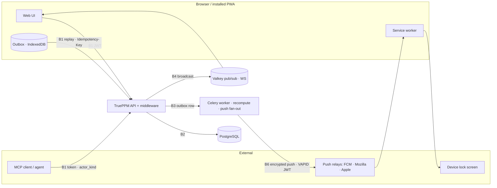

# Pass 4 — STRIDE threat model (pre-architect)

**Scope:** the trust-boundary changes in [README.md](README.md), the Pass 4 API and operations delta:
1. Agents capability enforcement
2. Web Push
3. The resourcing-ask approval path
4. The web offline write queue
5. Also: the capability toggle admin path, the Rate editor grant, and new broadcast payloads (expenses, asks)

**Status:** architecture stage, nothing built. Everything here is a design obligation for
`architect`. None of it is a finding against shipped code.

**Grounding, verified in the tree on 2026-11-22:**
- `AgentActorKind` has one value, `MCP_TOKEN`, a person's own `mcp:read` token (`agents/models.py`). First-class agent actors are #1063, which is open and `release::committed` for 0.5.
- Idempotency keys are scoped per user, hash-checked, and retained **24 h** (`IDEMPOTENCY_RETENTION_HOURS`, `idempotency/models.py`).
- `IsWorkspaceAdminStrict` exists (`workspace/permissions.py`). `IsOrgAdmin` is self-grantable through project creation.
- Gates added to `DEFAULT_PERMISSION_CLASSES` are inert where views override them. `DemoReadOnlyMiddleware` is the precedent for a middleware gate.
- The notification matrix already has a `MOBILE_PUSH` column that is undeliverable today (#3252).

---

## 1. Asset inventory

| Asset | Sensitivity | Why |
|---|---|---|
| Capability state (`WorkspaceCapability`) | Internal | Hides UI. For `agents` it is an **authorization control**. |
| Agent-actor credentials and their refusals | Restricted | A credential that can act on schedule data. |
| Resource asks and offer lines | Confidential | Names people, their load, and the projects competing for them. |
| Task assignments made by approval | Confidential | Moves CPM dates on another PM's project. |
| Cost rates (`Resource.cost_rate`, `bill_rate`) | Restricted | Per-person compensation proxy. |
| Expenses | Confidential | Commercial spend (licenses, cloud, agent token bills). |
| `RateEditorGrant` | Restricted | It widens who sees and changes rates. |
| Push subscriptions (endpoint, `p256dh`, `auth`) | Confidential | A capability to deliver content to a person's device. |
| VAPID private key | Restricted | Lets anyone send pushes as this install. |
| Push payload text (project, task and agent names) | Confidential | Leaves the trust boundary toward push relays and lock screens. |
| Offline outbox (IndexedDB) | Confidential | Unsynced structural edits held on the client. |
| Idempotency records | Internal | They hold the response body of a prior write. |
| Health band, PM override, `health_reported_at` | Internal | Read by sponsors and PMOs, and integrity matters. |

## 2. Trust boundaries

| Boundary | What crosses it | Obligations |
|---|---|---|
| **B1** Internet ↔ API | Ask transitions, capability PATCH, expense and rate writes, subscription registration, outbox replay, agent-token calls | Auth on every call. The **Agents gate runs as middleware** before view dispatch. Admin paths use `IsWorkspaceAdminStrict`. Every subscription `endpoint` is validated against a host allowlist. |
| **B2** API ↔ DB | Approval writes assignments, an `AskEvent` and the outbox row in **one transaction** | Row lock on the ask to stop double approval. Fit is rechecked inside the transaction. |
| **B3** API ↔ worker | Recompute after approval, push fan-out | Task arguments are IDs only, and the worker reloads and rechecks. Goes through the outbox (`on_commit` durability rule). |
| **B4** API ↔ pub/sub | `resource_ask.transitioned`, `expense.*`, `capabilities.changed` | **Payloads carry IDs only, never amounts, rates or note text.** Clients refetch through a permission-checked REST call. |
| **B6** TruePPM ↔ push relays | Encrypted payload (RFC 8291) and the VAPID-signed JWT | Default off. Egress allowlist. Payload is minimal text plus an item ID. Lock-screen details follow a per-user option (Q4.1). |
| **Client storage** (not in the standard six) | Outbox at rest on a shared or lost device | Bound to the user, purged on logout and after its TTL. Replay needs the same user's live session. |

## 3. STRIDE matrix

### 3.1 Agents capability enforcement
| Threat | Analysis | Mitigation / decision |
|---|---|---|
| **S** | An agent presents as a human. **Today there is no distinction.** Every MCP call is `actor_kind=MCP_TOKEN` on a personal token. “Refuse agent tokens, keep human MCP tokens” (Q1.8) is not expressible until #1063 ships first-class agent actors. | **Sequence it:** enforcement keys off the actor kind #1063 introduces. Until #1063 lands, “Agents off” must either refuse **every** MCP token, with the UI saying so (“MCP tokens are refused while Agents is off”), or the toggle ships hide-only with the enforced chip removed. Pick one (Decision D1). |
| **T** | A toggle flipped through a weak admin check. | `PATCH /workspace/capabilities/` requires `IsWorkspaceAdminStrict`. `IsOrgAdmin` is self-grantable and **must not** guard this. |
| **R** | Who turned agents off and when, and which calls were refused. | Workspace history row per toggle. Each refusal is recorded as an `AgentAction` (verdict `refused`, reason `capability_off`), which joins the existing hash chain (`audit_verify`). |
| **I** | A refusal message leaking workspace config. | A typed 403 naming only the capability: `{"code":"capability_off","capability":"agents"}`. |
| **D** | A refused agent retry-storming. | Existing throttles apply. Refusal rows are rate-sampled after N per token per minute, with the count kept, so the audit table can't be flooded. |
| **E** | A view that overrides permission classes bypasses the gate. Or a WS consumer, or a Celery path, acts on an agent's behalf after the flip. | The **middleware** gate covers every HTTP path. WS consumers check the capability on connect and on each agent-originated message. Worker tasks enqueued by an agent before the flip recheck the capability when they run. |

### 3.2 Web Push
| Threat | Analysis | Mitigation / decision |
|---|---|---|
| **S** | Someone sends pushes as the install if the VAPID private key leaks. A user registers a subscription for another user. | VAPID comes from `existingSecret` or a `lookup`-stable chart secret, never logged or exported. A subscription is always bound to `request.user` server-side, and a `user` field in the body is ignored. |
| **T** | A crafted subscription endpoint. **SSRF: the server POSTs to a user-supplied URL.** | **Allowlist the endpoint host** to known push services (`fcm.googleapis.com`, `*.push.services.mozilla.com`, `*.push.apple.com`, `*.notify.windows.com`). Require `https`, no redirects, and a short timeout, and reject private and link-local IPs after DNS resolution. Admins can extend the allowlist in Helm. |
| **R** | Was a push delivered? | `last_delivered_at` and `failed_count` per subscription, plus a per-dispatch log line with the item ID only, no content. |
| **I** | Content on the lock screen and at the relay. Payloads are end-to-end encrypted to the browser (RFC 8291), so relays see metadata only. The lock screen shows the text to anyone holding the device. | Payload is minimal: title, short body and item ID, never rates, amounts or note text. A per-user option for “details on lock screen” (Q4.1) is **recommended on by default but needs a decision** (D3). The agent refusal names the agent and task, not schedule data beyond that. |
| **D** | Subscription flooding, and slow relays blocking workers. | At most N subscriptions per user (proposed 10). Fan-out runs in its own queue with timeouts. 404/410 deletes the subscription, and repeated failures disable it. |
| **E** | Push used to probe for internal services (the SSRF above). | The allowlist and IP checks above. No push dispatch runs in the API request thread. |

### 3.3 Resourcing ask approval path
| Threat | Analysis | Mitigation / decision |
|---|---|---|
| **S** | A non-manager approves. | `/approve`, `/counter`, `/decline` and batch approve require the caller to be a **manager of the ask's pool**, checked against the pool, not the project. |
| **T** | **Cross-project write by a non-member.** A pool manager may hold no role on the requesting project, yet approval writes assignments there. | **Consent-bounded write:** the PM's ask is the authority. Approval may only assign **pool members** to **exactly the ask's covered tasks**, within the asked window and units. Counter-offer lines must be a subset of the covered tasks. The server rejects anything else. The assignment is attributed to the pool manager, with `via_ask=<id>`. |
| **T** | A race: double approval, or approving a stale fit (TOCTOU), especially in a batch. | `select_for_update` on the ask. Fit is recomputed inside the transaction, and batch approve refuses any item whose fit is no longer `fits`, per item. State transitions are validated server-side. |
| **R** | Who approved, what fired, what moved. | An `AskEvent` per transition (actor, from, to, `run_id`). The explained-change outcome is persisted with the run ID. `sprint.scope_changed` fires for sprint tasks. |
| **I** | Heat-map holds and per-person load seen by PMs outside the pool. Ask notes. | The pool load and holds endpoint is limited to pool managers, members' own rows, and workspace admins. A PM sees fit as a verdict (✓/◆/▲ plus words), not other people's load numbers. WS payloads carry IDs only (B4). |
| **D** | Ask spam to a pool. | A per-user rate limit on ask creation, a cap of open asks per project per pool, and drafts excluded from manager queues. |
| **E** | An agent pushes an ask through. | Agent actors may create `draft` only. `send`, `approve` and `batch-approve` reject agent actors, and this becomes enforceable once #1063 exists (see 3.1 S). |

### 3.4 Web offline write queue
| Threat | Analysis | Mitigation / decision |
|---|---|---|
| **S** | A different user, on the same browser profile, replays someone else's queue. Or an agent token rides a human queue. | Outbox records carry the user ID, replay needs that user's live session, and the queue is purged on logout and on user switch. The server ignores any actor in the payload and uses `request.user`. |
| **T** | **Late replay past idempotency retention.** Keys live 24 h, the queue up to 7 days. After 24 h a replayed PATCH is no longer deduplicated, and it can **blindly overwrite** a field someone changed since. | Every queued update carries a **precondition** (the row's `server_version` at edit time, sent as `If-Match` or a body field). The server returns 409 conflict when the row moved. Creates use client-minted UUID primary keys (ADR-0772), so a duplicate create can't double-insert. Then either raise retention to at least the queue TTL, or set the queue TTL to the retention window. **Decide which (D2).** *(Resolved, see D2 below: `X-Base-Version`, 72 h TTL, ADR-1465.)* |
| **T** | Edits tampered with at rest in IndexedDB, for example by a malicious extension or XSS. | Accepted risk, because the client is already trusted for what its user can do. The server re-authorizes every replayed write as if it were fresh, and the queue grants no permission. Mitigate XSS through the existing CSP. |
| **R** | Who made an offline edit, and when. | Server records the replay time and actor, with a `client_edited_at` hint, labeled client-reported and never used for ordering decisions. |
| **I** | Queue contents left on a lost or shared device. The 409 payload exposes `server_value` and `server_actor`. | Purge on logout and after the TTL. Drop the “encrypted at rest” claim unless a non-exportable WebCrypto key is used and its scope is documented (Q6.5). The 409 returns the remote value only if the caller can read that field, and names the actor only if the caller can see project members. |
| **D** | Huge or poisoned queues, and replay storms after reconnect. | A client cap on queue size, server batch limits on `tasks/bulk`, existing throttles, and exponential backoff on 429. |
| **E** | A queued edit that was authorized when made but the user lost the role since. | Re-authorize at replay. The edit fails with “✕ Failed · you no longer have edit access”. The queue never carries authorization. |

### 3.5 Rate editor grant, capability admin and broadcasts
| Asset | Key threats → mitigation |
|---|---|
| `RateEditorGrant` | **E:** granted through a self-grantable admin check. Use `IsWorkspaceAdminStrict` only. **I:** rates through other paths. Omit them from the serializer, **WS broadcast**, exports, MCP and error messages alike, and add a test asserting absence on each path. **R:** grant changes go to workspace history. |
| Expenses | **I:** amounts in `expense.*` broadcasts reach every board subscriber, including Viewers. The payload is the ID only, and amounts come from REST with permission checks. |
| Capability toggles (non-agents) | Hide-only by decision. **R:** history row. **I:** `capabilities` on `GET /workspace/` is readable by members, which is acceptable because it is not sensitive. |

## 4. Top risks (likelihood × impact)

1. **Agents enforcement can't tell an agent from a human today.** Likely × high. As specified, “Agents off” either blocks every MCP user or silently blocks nothing, while the UI says “Enforced”. Mitigation: D1, gating enforcement on #1063's actor kind or labeling it honestly as “all MCP tokens”.
2. **Offline replay after the 24 h idempotency window overwrites newer data.** Likely for PWA users offline across a weekend × medium-high: a silent overwrite of a colleague's edit, the exact trust failure the panel and the category evidence name. Mitigation: per-edit `server_version` preconditions, plus aligning retention and queue TTL (D2). *(Resolved, see D2 below.)*
3. **Push subscription endpoint as SSRF.** Medium likelihood × high impact, because the server makes outbound requests to user-supplied URLs inside the cluster network. Mitigation: host allowlist, IP checks, no redirects, dispatch off the request path.

Close behind: the cross-project write by a pool manager (mitigated by the consent-bounded write rule), and rate and amount leaks through broadcast (IDs-only payloads).

## 5. Decisions for the architect

- **D1 — decided 2026-11-22:** before #1063, “Agents off” refuses **all MCP tokens**, and the UI says so (canvas 1A and 1C updated). When #1063 introduces agent actor kinds, enforcement narrows to them, and a person's own MCP token then keeps working.
D2–D6 are resolved in the ADRs (Proposed, 2026-11-22):
- **D2 → ADR-1465:** updates replay with `X-Base-Version` (ADR-0217 merge), which is the overwrite guard. Idempotency retention stays at 24 h, and the queue TTL is 72 h. Expired entries are shown, never replayed silently.
- **D3 → ADR-1463:** a per-user “details on lock screen” setting, default on. An operator Helm value `push.lockScreenDetails: minimal` can force minimal content.
- **D4 → ADR-1463:** yes, the allowlist is extendable through `push.allowedEndpointHosts`. The default list is the major browser push services.
- **D5 → ADR-1461:** the write is recorded as the pool manager, with `via_ask`.
- **D6 → ADR-1461:** requesting PMs see fit verdicts only (ADR-0963 bounded disclosure).
- **Correction:** “ADR-0133” in this document refers to task capabilities, not health (see ADR-1464). And D1 is satisfied by the existing `Workspace.mcp_enabled` guard (ADR-0678/0497, see ADR-1460), not new middleware.

## 6. SOC 2 control mapping

| Mitigation | Trust Services Criteria |
|---|---|
| `IsWorkspaceAdminStrict` on toggles, grants and pools; pool-manager checks on approvals; consent-bounded writes | CC6.1 (logical access), CC6.3 (role-based access, least privilege) |
| Middleware Agents gate; agent draft-only asks; re-authorization on offline replay | CC6.1, CC6.2 (access removal is effective), CC6.8 (unauthorized software and actors) |
| Hash-chained `AgentAction` refusals; `AskEvent` trail; workspace history for toggles and grants | CC7.2 (monitoring), CC4.1 (evaluations), CC7.3 (incident evaluation) |
| Push endpoint allowlist and IP checks; egress default off; VAPID secret handling | CC6.6 (external threats at boundaries), CC6.7 (data transmission), CC6.1 |
| IDs-only broadcast payloads; rates omitted on every path; minimal push payloads | C1.1 (confidential information protected), CC6.7 |
| `server_version` preconditions; idempotency; row locks and in-transaction fit recheck | PI1.2 / PI1.3 (processing integrity: complete, accurate, authorized processing) |
| Outbox durability for recompute; dead-letter metrics | A1.2 (availability, recovery), CC7.2 |
| Queue purge on logout and TTL; subscription cleanup | C1.2 (disposal of confidential information) |

## Gate ledger

`gate: threat-model — 3 top risks, 6 decisions`. Pass this file to `architect` along with
[README.md](README.md). The confidential-finding rule doesn't apply here, because nothing is
built and no finding concerns shipped behavior.
