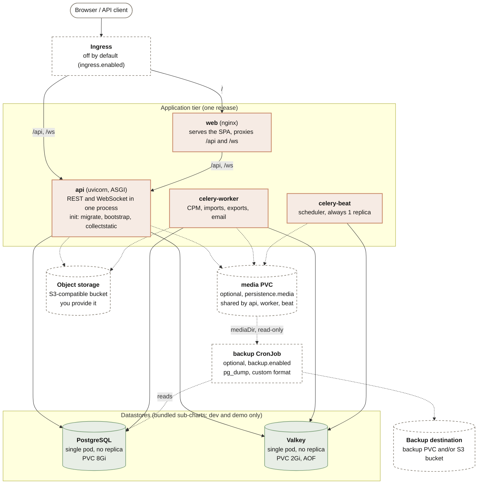
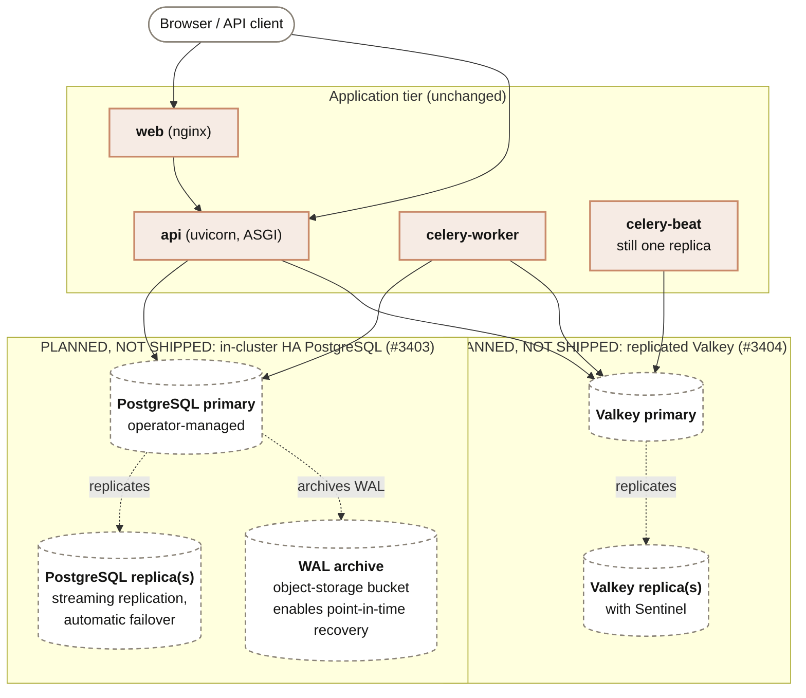

This page draws the Kubernetes deployment two ways: **what the Helm chart renders today**, and **what the high-availability epic ([#3408](https://gitlab.com/trueppm/trueppm/-/issues/3408)) plans to add**. They are separate diagrams on purpose. Nothing in the second one is in the chart yet, and a single diagram would make it look as though it is.

Use it with [Deployment](/administration/deployment/) to install, [Backup & Restore](/administration/backup-restore/) to recover, and [Durability & Redundancy](/administration/durability/) for what each failure costs.

## Ships today

The chart renders five long-running workloads plus two optional ones. Everything below is verified against `packages/helm/templates/` and `values.yaml`.

Solid boxes are rendered by a default install. Dashed boxes are opt-in or something you supply. Two things the diagram deliberately does not draw because the chart does not render them: there is **no separate WebSocket (Channels) deployment**, since the `api` pod runs `uvicorn trueppm_api.asgi:application` and serves REST and WebSocket together; and there is **no migration Job**, since each `api` pod runs `migrate_locked` as an init container, which serializes concurrent pods on an advisory lock.

### What the chart does and does not give you

- **One PostgreSQL pod, one Valkey pod.** The bundled sub-charts are single-replica StatefulSets with `ReadWriteOnce` PVCs. They survive a container restart because the data is on the volume. They do not survive the loss of their pod or node, and because `/api/v1/readyz` checks a live cache round-trip, losing Valkey marks every `api` pod `NotReady`. See [Valkey High Availability](/administration/valkey-ha/).
- **No point-in-time recovery and no in-cluster HA today.** The chart has no WAL archiving, so recovery is to the last logical backup. The production overlay (`values-prod.yaml`) disables both sub-charts and points `DATABASE_URL` and `REDIS_URL` at managed services; that is the supported way to get HA or PITR before 0.5.
- **`replicaCount` scales `api`, `celery-worker` and `web`, not `celery-beat`.** Beat is pinned to one replica, because a second one double-fires every periodic task.
- **The `web` pod is the front door.** With the Ingress path split in `values.yaml`, `/` goes to `web` and `/api` and `/ws` go straight to `api`. The `web` pod also proxies `/api/` and `/ws/` to `api`.
- **The demo seed Job and demo reset CronJob** exist only when `demo.enabled` is set, and are left out.

### What a backup and restore must cover

| Data | Where it lives | In the chart's backup? |
|---|---|---|
| Application database | PostgreSQL volume (8Gi PVC on the bundled sub-chart, or your managed database) | **Yes.** The CronJob runs `pg_dump --format=custom`. |
| PostgreSQL extensions `ltree`, `pg_trgm`, `btree_gist` | Created in the database by the application's migrations | Preserved by the custom-format dump. A managed database must allow them. A restore fails loudly if they are missing. |
| Attachments and export bundles | The media PVC if you use local storage, otherwise the object-storage bucket | Media PVC: only if you set `backup.mediaDir` and mount the claim read-only. Bucket: **no**, back it up with the object store's own tooling. |
| Valkey (broker, Channels layer, cache, throttle counters) | Valkey volume (2Gi PVC, AOF) | **No, by design.** It holds reconstructible state only. |
| `INTEGRATION_ENCRYPTION_KEY` and the other application Secrets | Kubernetes Secret | **No.** The dump is useless without the key, so back it up separately. |
| Backup artifacts | The backup PVC, an S3-compatible bucket, or both | They are the output, not an input. The chart refuses to render an enabled backup with nowhere durable to write. |

The backup is off by default (`backup.enabled: false`). Restores are manual, using `scripts/restore.sh`; see [Backup & Restore](/administration/backup-restore/) for the runbook and the restore drill.

## Planned HA topology

:::note[Ships in 0.5]
Everything in this section is **planned for 0.5** under the cloud-native epic ([#3408](https://gitlab.com/trueppm/trueppm/-/issues/3408)) and is **not in the chart today**. The current release deploys the single-pod datastores shown above. Scope and details may change before release; the [roadmap](/overview/roadmap/) is the source of truth.
:::

The application tier does not change. What 0.5 plans to change is the two datastores:

Dashed boxes are planned. In this diagram only the application tier exists today.

This is the **single-cluster** line: surviving the loss of a pod or node inside one cluster. It does not survive the loss of the cluster or the region. Cross-region replication, geo failover and managed backup verification are Enterprise features and are not drawn here.

A few things to plan around while this is still ahead of you:

- **Managed services remain fully supported** and are the way to get HA or PITR today. Nothing in the planned work removes that option.
- **A logical backup stays useful.** WAL archiving adds point-in-time recovery; it does not replace the dump-and-restore runbook above, and Valkey is still not part of any backup.
- **Sentinel client support already exists, but no Sentinel nodes are deployed.** The chart can be pointed at Sentinels you run yourself (`valkey.sentinel`, experimental). What is planned is the chart standing up the replicated Valkey for you.
