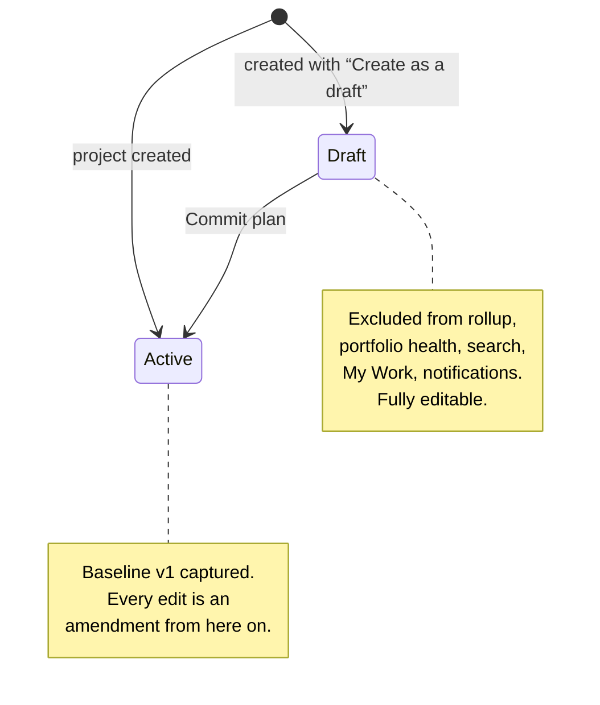
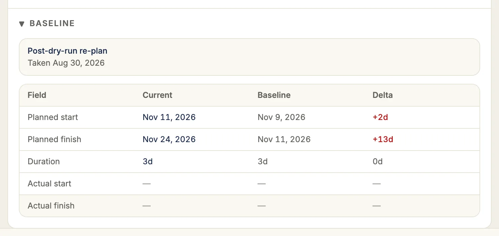

A **baseline** is a frozen snapshot of your project's schedule at a point in time. Capture
one when you commit a plan to stakeholders, then compare it against the live schedule to
see exactly how far — and which tasks — have drifted.


## Committing the plan

Most projects get their first baseline automatically, by being **committed**.

A project can be created as a **draft** — a plan nobody has agreed to yet. Tick
**Create as a draft** in the footer of the New project sheet; leave it unticked and the
project is created active, which is the default.

A draft is fully writable; what it is not is *visible*. TruePPM holds a draft out of
program rollup, portfolio health, search, My Work and the notification fan-out, so a
half-built plan cannot quietly become part of an aggregate someone reports upward.

Committing ends that. On the project **Overview**, a draft shows a **Draft** chip, and a
Project Manager sees a **Commit plan** button beside **Update Status**:



Committing happens in one step and does two things at once:

1. **Captures `Baseline v1`** and makes it active — including a copy of the working
   calendar the dates were computed against, stored *by value*. A later calendar edit
   therefore changes your variance rather than silently moving the thing variance is
   measured from.
2. **Flips the project from draft to active**, so it joins every aggregate it was held
   out of.

You can keep editing afterwards — committing is not a lock. What changes is that editing
a committed plan is **amending** it: the edit is recorded in the project's
[change history](/features/change-history/) and the people who hold an assignment on the
changed work are notified.

The plan's **changeset**, which ships in 0.5, collects structural amendments so each can be
given a reason afterwards; see [Changing a committed plan](#changing-a-committed-plan-the-changeset).

**You cannot un-commit.** A plan is committed once, so that the anchor every variance
number is measured from cannot move — trying to commit an already-active plan again
is refused.

If you're automating this instead of using the button, the same action over the API
looks like:

```bash
# Commit the plan. Requires the Project Manager role. Returns 409 if already committed.
curl -X POST -H "Authorization: Bearer $JWT" \
  https://trueppm.example.com/api/v1/projects/$PROJECT_ID/commit/
```

```json
{
  "baseline_id": "8f14e45f-ceea-467a-9f6b-2c1a3e9d4b70",
  "baseline_name": "Baseline v1",
  "task_count": 12,
  "assigned_resource_count": 4
}
```

`assigned_resource_count` is how many people hold a resource assignment in the plan you
just committed — the audience the commit concerns. It is **not** a count of notifications
sent; committing sends none. People are notified when their work later *moves*, which is
the amendment path described above.

| Method & path | Purpose | Permission |
|---|---|---|
| `POST /api/v1/projects/{id}/commit/` | Commit the plan; capture `Baseline v1` | Project Manager (`ADMIN`) |

Structured rebaseline reasons and a post-commit changeset view also ship in 0.5.

## Capturing and managing baselines in the app

Beyond the automatic `Baseline v1`, you can capture further baselines at any time — for
example one per phase gate.

From the **Schedule** view, open the toolbar's **Actions** menu:

- **Capture baseline** takes a snapshot of every task's current planned dates. It
  requires the Project Manager role, auto-names the snapshot (`Baseline N`), and makes it
  active. A short confirmation first explains what a baseline is and — if one is already
  active — reminds you that capturing a new one keeps the previous baseline in the
  project's history rather than overwriting it. You can also capture from the **Baseline**
  section of a task's detail drawer when no baseline exists yet.
- **Baselines…** opens the baseline manager, where any project member can see every
  baseline (name, capture date, and task count) and which one is active. A Project
  Manager can **Set active** to switch the comparison baseline on a draft plan (a committed plan hides it: its baseline moves only through **Take v2** in the changeset review), and a Project Owner can
  **Delete** one.

The same operations are available through the [REST API](#capturing-and-managing-baselines-via-the-api)
for automation. Baseline ghost bars drawn directly on the Gantt canvas and structured
rebaseline reasons are planned for 0.5.

## What a baseline captures

Capturing a baseline records, for every task in the project at that moment:

- the task name (kept even if the task is later deleted),
- planned **start** and **finish** dates,
- **duration**, and any **actual** start/finish already recorded.

Snapshots are **immutable** — once written, a baseline's task rows never change, so a
baseline remains a faithful record of what the plan looked like when you took it. A
baseline notes whether its tasks had computed CPM dates at capture time, so a comparison
can flag a snapshot that was taken before the schedule was fully calculated.

## Multiple baselines

A project can hold **many baselines** — for example one per phase gate — but **one is
active** at a time. The active baseline is the one used for comparison. Activating a
different baseline automatically deactivates the previous one.

## Changing a committed plan: the changeset

:::note[Ships in 0.5]
The changeset, its reason line, the review sheet and the two exits below ship in 0.5. In
the current release a committed plan's amendments are recorded in change history without a
reason, and a Project Manager switches the comparison baseline with **Set active**.
:::

Committing is not a lock. After baseline v1 you keep editing the plan with the same
gestures, and nothing waits for you to explain yourself first. What changes is that every
**structural** edit (adding, moving or deleting a task) joins an open **changeset**: the
set of changes made since the active baseline, each with room for one line of *why*.

- **What counts.** Adding a task or phase, moving one (indent, outdent, reparent, reorder,
  group, ungroup), and deleting one. Date, duration, owner and status edits never join, and
  neither does moving a card between sprints or from the backlog into a sprint.
- **The edit applies first.** An entry is created the moment the edit lands, with no
  reason. A Scheduler, Project Manager (`ADMIN`) or Owner answers it afterwards, or gives
  the reason with the edit itself. A Member's structural edit joins the changeset too, always
  without a reason (a reason sent with a Member's edit is not stored), and someone at
  Scheduler or above answers it.
- **Related acts group.** Acts of the same kind, on the same surface, by the same person,
  within two minutes of each other share one entry and one reason. One multi-select action
  is one entry. Answering an entry closes it, so a later act opens a new one. In the app,
  the Grid, Outline, Timeline and Board are separate surfaces, so a Board drag never joins
  a Grid restructure. Switching view or mode, opening the review, or leaving or reloading
  the page also closes the open entry, so the next act starts a new one.
- **A reason is set once.** It cannot be rewritten afterwards.
- **Undo retracts the act it undoes, and only that act.** Restoring a deleted task takes
  back the delete, undoing a paste or a CSV import takes back the add, and undoing an outline
  restructure takes back the move. An earlier add or a later move of the same task stays
  listed, because it still happened. Undoing the last act in an entry deletes the entry.
- **Not yet in the changeset.** Tasks added by an inbound task push, by promoting a sprint to
  a milestone, by applying a template, or by a recurring task's next occurrence do not open
  an entry yet. That is tracked in
  [#5126](https://gitlab.com/trueppm/trueppm/-/issues/5126). <!-- TODO(#5126) -->

### The two exits

When you review the changeset, there are two equal ways out, and both are recorded on the
project's decision trail:

- **Take a new baseline (v2).** Needs a reason code (approved scope change, sponsor moved
  the commitment, external delay, estimate correction, team change, calendar change) and a
  written reason. It is refused while any change still needs a reason. The changes it
  covers are resolved.
- **Keep the current baseline and let variance stand.** Always available, with an optional
  note. The changes stay listed, and the next structural edit brings the review back.

Re-baselining is for a plan that was re-agreed, not for turning a red number green. Only a
Project Manager (`ADMIN`) or Owner takes either exit, and only from a signed-in session: an
API token cannot re-baseline a plan.

### Reviewing the changeset in the app

Only Schedulers, Admins and Owners see any of this. Members' edits still join the
changeset, and the plan owner answers them.

- **The header.** Once a committed plan has open changes, the project header and the
  Schedule view show **◷ N changes open · M need a reason** with a **⚑ Review N changes**
  button. After you keep the baseline, the button steps down to **◷ N changes · v1 kept**
  until the next structural edit lands.
- **The reason line.** Right after a structural edit, a line under the Schedule toolbar
  says what happened in the system's words, such as *Structural repairs moved · finish
  Nov 14 → Nov 19*, with a **Why?** field. It never takes focus by itself; press
  **⌥W** (Alt+W) to reach the field, type the reason and press Enter. **Esc** or **✕**
  dismisses the line without answering, and the change stays marked.
- **The review sheet.** **Review** opens a sheet that lists changes that need a reason
  first, each with its author, time and finish impact. A change with no reason has a field
  to answer it in place. Below the list are the net effect on the finish and the two exits
  as equal cards. Neither is the default: Enter chooses nothing, and **Esc** or **✕**
  closes the sheet without deciding.
- **On a phone.** Instead of the header, a card at the top of the Schedule shows
  **◷ N changes open since v1** with the date of the first open change, the finish against
  v1 (*Finish Nov 14 → Nov 19 · +3 wd vs v1 · as of 15:22*), and **Review N changes**.
  Under it, a note says that adding, moving and deleting tasks is on desktop and what the
  phone can still do (update status, % complete and dates, review the changeset, and give
  a missing reason). **Copy link** copies the page's address, and **Email it to me** opens
  a draft in your mail app addressed to your own account's email only. The sheet fills the
  screen, and the two exits sit in a sticky footer as equal buttons. **Take v2…** opens a
  step for the reason code and the reason. **Keep v1** takes one tap and shows an **Undo**
  for 10 seconds before the decision is recorded.
- **Offline.** Both exits are disabled with **Reconnect to decide**, and the reason you
  typed is kept on the device.
- **If the changes moved.** If someone else changed the plan after you opened the sheet,
  the decision is refused and the sheet reloads the current list.

On a committed plan, the active baseline moves only through this decision. Activating a
different baseline directly is refused, though you can still capture a named baseline to
compare against.

## Capturing and managing baselines via the API

All endpoints are project-scoped and authenticated with a bearer token (`$JWT`);
`$PROJECT_ID` is the project UUID.

```bash
# 1. Capture a baseline (name optional — auto-named "Baseline N" if omitted).
#    Requires the Project Manager role. Snapshots every task atomically.
curl -X POST -H "Authorization: Bearer $JWT" -H "Content-Type: application/json" \
  -d '{"name": "Phase 1 commit"}' \
  https://trueppm.example.com/api/v1/projects/$PROJECT_ID/baselines/

# 2. List baselines for the project.
curl -H "Authorization: Bearer $JWT" \
  https://trueppm.example.com/api/v1/projects/$PROJECT_ID/baselines/

# 3. Activate a baseline (deactivates any other). Requires the Project Manager role.
curl -X POST -H "Authorization: Bearer $JWT" \
  https://trueppm.example.com/api/v1/projects/$PROJECT_ID/baselines/$BASELINE_ID/activate/

# 4. Delete a baseline. Requires the Project Admin (owner) role.
curl -X DELETE -H "Authorization: Bearer $JWT" \
  https://trueppm.example.com/api/v1/projects/$PROJECT_ID/baselines/$BASELINE_ID/
```

| Method & path | Purpose | Permission |
|---|---|---|
| `GET /api/v1/projects/{id}/baselines/` | List baselines | Project member |
| `POST /api/v1/projects/{id}/baselines/` | Capture a baseline (auto-named if blank) | Project Manager (`ADMIN`) |
| `GET /api/v1/projects/{id}/baselines/{baselineId}/` | Retrieve (with task count) | Project member |
| `POST /api/v1/projects/{id}/baselines/{baselineId}/activate/` | Make active, deactivate others. On a committed project, refused with `409 use_baseline_decision` | Project Manager (`ADMIN`) |
| `GET /api/v1/projects/{id}/changeset/` | Open changes since the active baseline, unanswered first, with counts, the finish against the baseline and `_provenance` | Any project member |
| `PATCH /api/v1/projects/{id}/changeset/entries/{entryId}/` | Answer an entry's reason once (`{"reason": "..."}`). A second answer is `409 reason_already_set` | Scheduler (`SCHEDULER`) |
| `GET /api/v1/projects/{id}/baseline-decisions/` | The decision trail, newest first | Any project member |
| `GET /api/v1/projects/{id}/baseline-decisions/preview/` | What taking a new baseline would do: finish before and after, milestones that move, tasks with new dates | Project Manager (`ADMIN`) |
| `POST /api/v1/projects/{id}/baseline-decisions/` | Take a new baseline (`kind: "taken"`) or keep this one (`kind: "kept"`). Send `expected_open_count`; a stale count is `409 changeset_changed`, and an unanswered change blocks `taken` with `409 changeset_unreasoned` naming the entries | Project Manager (`ADMIN`), signed-in session only |
| `DELETE /api/v1/projects/{id}/baselines/{baselineId}/` | Delete a baseline | Project Admin (`OWNER`) |

## Baseline bars on the Gantt

:::note[Ships in 0.5]
Baseline bars on the Gantt ship in 0.5. In 0.4 the comparison is the per-task table
described in [Comparing against the plan](#comparing-against-the-plan).
:::

While a baseline is **active**, the Schedule draws it behind your tasks: a hollow outline
spanning each task's baseline start and finish, sitting just behind the live bar. Where a
task has slipped or been pulled in, the outline is left showing on the side where the bar
moved away from the plan, so you can see which work moved across the whole schedule at once.

- Turn it on or off from **Display → Chart → Baseline bars**. The row appears only when the
  project has an active baseline, and the choice is remembered in your browser.
- The legend names it as **Baseline (planned)** while it is drawn.
- Only the active baseline is drawn. Phases (summary rows) and milestones do not get an
  outline yet; use the task detail's comparison table for those.
- A task added after the baseline was captured has no outline.

## Comparing against the plan

Once a baseline is **active**, opening a task in the Schedule view shows a **Baseline**
section in the task detail drawer with the planned-vs-current comparison for that task:



| Planned (baseline) | Current (live) | Delta |
|---|---|---|
| Start / finish at capture | Start / finish from the latest CPM run | Variance in days (e.g. `+3 days`) |

The same per-task comparison is available directly from the API:

```bash
# Active baseline vs current schedule for a single task.
curl -H "Authorization: Bearer $JWT" \
  https://trueppm.example.com/api/v1/projects/$PROJECT_ID/tasks/$TASK_ID/baseline/
```

The response is discriminated by `has_baseline` / `in_baseline`: it reports no baseline,
a task added after the baseline was taken, or a full comparison row with
`start_delta_days` / `finish_delta_days` (positive = slipping later than planned).
Both are calendar days, measured in working time: a milestone shown at the start of a
Monday is at the same point as one shown at the end of the Friday before it, so a
milestone baselined at Friday's end and now shown at Monday's start reads `0`, not `3`.
Each task in a baseline's detail (`GET /api/v1/projects/{id}/baselines/{baseline_id}/`,
`tasks[]`) records which edge of the day its finish sat on as `finish_at_day_start`.
For a baseline captured before TruePPM recorded it, the finish is read as the end of its day.

The task list carries the same comparison on every task, so a client does not have to
subtract dates itself: `baseline_finish_variance_days` is the forecast finish against the
active baseline's finish, and `schedule_variance_days` is the actual finish of completed
work against it. Both are measured in working time the same way and are `null` when
either date is missing. The baseline chip on a board card and in the task drawer shows
`baseline_finish_variance_days`.

`current_start` and `start_delta_days` compare against the task's **span**
(`scheduled_start` — see [the bar vs. the remaining-work
window](/features/schedule/dates/#the-bar-vs-the-remaining-work-window)), not the
narrower *remaining-work* window that `early_start` shrinks toward as an
in-progress task approaches completion. Comparing against the remaining-work
window would make `start_delta_days` grow purely from progress being
reported, not from any actual schedule slip.
