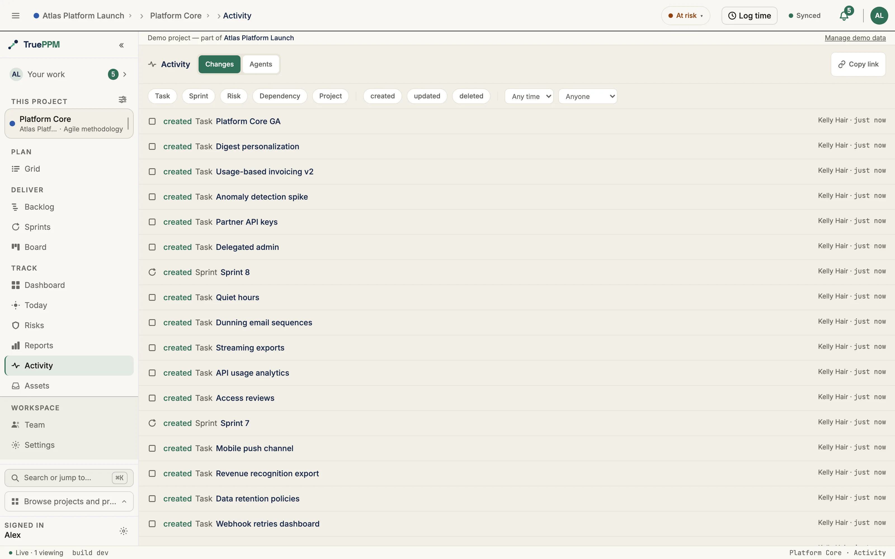

Every project has an **Activity** tab — one screen that answers *"what changed in
the last week?"* across the whole project. Where [Change History](/features/change-history)
shows the history of a *single* task, project, or sprint, Activity **unifies every
object type into one newest-first stream**: tasks, sprints, risks, dependencies,
recurrence rules, and project-settings policies, all in one place.

:::note[Edition]
Project Activity is part of the **Community (OSS)** edition. It is a read-only view
built on the same change-history data as [Change History](/features/change-history) — no new data is
recorded. Cross-**portfolio** activity digests and an immutable, cryptographically
signed audit trail are **Enterprise** features.
:::

## Opening the Activity view

Open a project and select the **Activity** tab (in the *Track* group of the view
bar, alongside Today, Risks, and Reports). You'll see a reverse-chronological list:
each row shows the change type, the object it affected, its name, how long ago it
happened, and — for project admins — who made it.



:::note[Ships in 0.5]
Row kinds, value changes, and folded repeats ship in 0.5. In the current release
every task-backed row reads *Task*, an update lists only the names of the changed
fields, and a run of identical changes shows as one row per change.
:::

Each row tells you, at a glance:

- **What changed** — a verb (`created`, `updated`, `deleted`) paired with what the
  object is and its name, e.g. *"updated Story · Design the API"*. Task-backed rows
  will name their kind: *Milestone*, *Story*, *Bug*, *Epic*, *Spike*, *Tech Debt*,
  *Mitigation* (a task linked to a risk), or *Task*.
- **What it changed from and to** — for an update, each changed field will be
  listed beneath with its old and new value, e.g. *"Status: Not started → In
  progress"*, by the same labels the task drawer's Activity tab uses (*Status*,
  *Outline position*), never as database column names. A soft delete reads
  *Deleted* (or *Restored*). A field that points at another record (*Assignee*,
  *Sprint*, *Epic*) will read *"Assignee changed"*: the feed carries the record's
  id, not its name, so it names the field rather than print an id. Past three
  fields, the rest collapse into *"+N more fields"*.
- **How many times** — consecutive changes that would read identically (same
  object kind and name, same actor, same fields and values) will fold into one row
  with a count, e.g. *"×5"*. For readers who cannot see the actor (Members and
  Viewers), runs by different people fold too, since the actor is not part of
  what they see. The row shows the newest of them and opens that
  object. A change to anything else in between breaks the run.
- **When** — a relative time ("5m ago", "2d ago").
- **Who** — the actor's name, shown to **project admins and owners** only. Members
  and Viewers see the change itself but not the user, by design (the same rule as
  Change History).

Click any row to **jump straight to the affected object** — a task opens its
detail, a risk opens the Risk register, a sprint opens the sprint list, and a
settings change opens the project settings.

## Filtering

Filter chips and selectors narrow the stream to exactly what you need:

- **Object type** — show only tasks, only risks, only sprints, and so on (multi-select).
- **Change type** — `created`, `updated`, or `deleted` (multi-select).
- **Date range** — the last 24 hours, 7 days, or 30 days (or any time).
- **User** — everything a specific person changed. This selector is honored for
  **admins and owners** only; lower roles cannot slice the feed by person, so the
  view can never become a per-person activity tracker.

The filters live in the URL, so the view is **deep-linkable**. Set the filters you
want, hit **Copy link**, and paste it into Slack — the recipient lands on the exact
same filtered feed ("the changes since last Tuesday"). The list uses **infinite
scroll**: it loads more automatically as you reach the bottom, backed by a stable
cursor so nothing is ever skipped or shown twice.

## What is and isn't included

Activity aggregates the **project-scoped** history tables: tasks, sprints, risks,
dependencies, task-recurrence rules, the project itself, and the guardrail,
signal-privacy, and decisions policies. It shares one field policy with the
task drawer's Activity tab, so a change hidden on one surface is hidden on the
other: **CPM-derived fields** (early/late dates, float, critical-path flag), **sync
bookkeeping**, low-signal housekeeping columns (sprint reorder ranks, derived
timestamps), and the private **blocker reason** field are never shown. The one
deliberate difference: a task's soft delete appears here as *updated Task ·
Deleted*, because this stream is the only record of it — the drawer of a deleted
task cannot be opened.

**Program-level** changes (a program's own settings, ceremony templates) are **not**
in a project's Activity feed — Activity is single-project by design. Per-user or
team-private data (time entries, retrospectives) never appears, because it isn't
recorded in the shared history tables at all.

## For integrators

Activity is backed by a documented, read-only endpoint:

```http
GET /api/v1/projects/{id}/changelog/?since=&object_type=&change_type=&user=&cursor=
```

It returns a newest-first page plus an opaque `next_cursor`. Each entry will carry
`object_kind` and `object_kind_label` next to `object_type` (from 0.5): a task-backed
entry's kind is `milestone`, `epic`, `story`, `bug`, `spike`, `tech_debt`,
`mitigation` (linked to a risk), or `task`, and every other source repeats its
`object_type`. The kind is read from the history row, so an entry reports what the
object was at that change; the risk link has no history, so `mitigation` reflects
the link as it stands now. Folding repeats is a display choice of the Activity
tab: the endpoint returns every row. The cursor is a stable
keyset (safe to persist, no duplicates or gaps across pages even when writes land
mid-scroll), which makes the endpoint a reliable substrate for a polling
integration. See the [API reference](/api/reference/) for the full parameter and response
contract.
