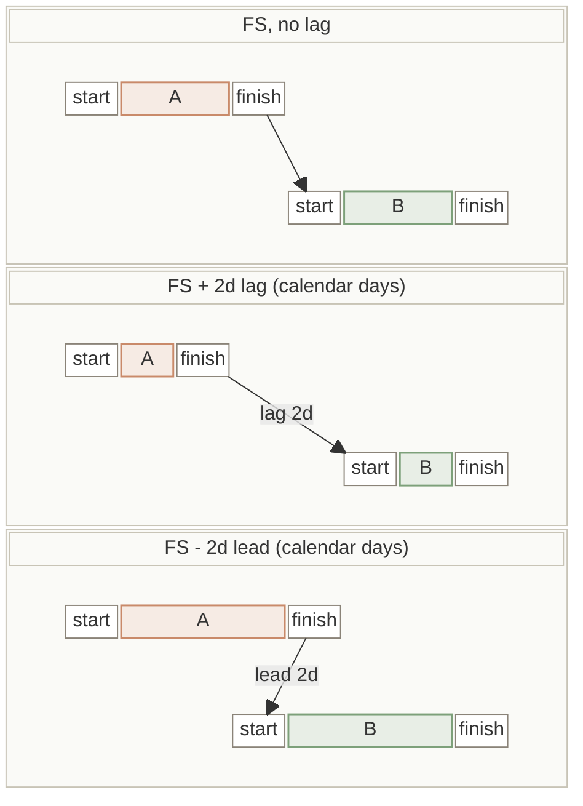
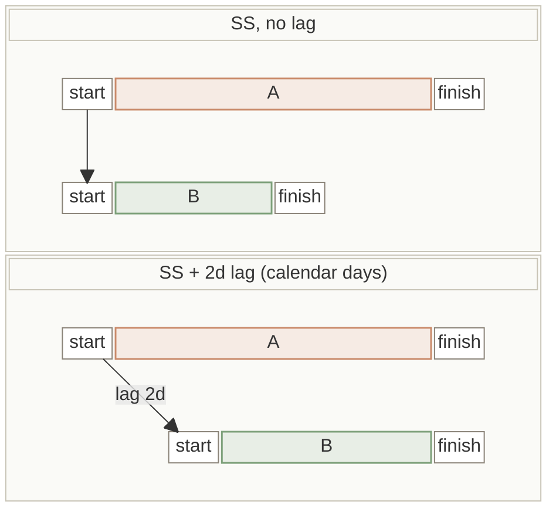
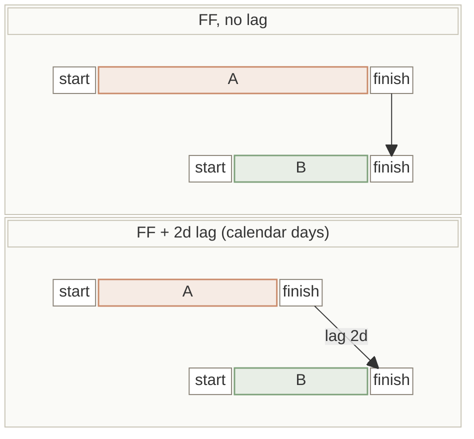
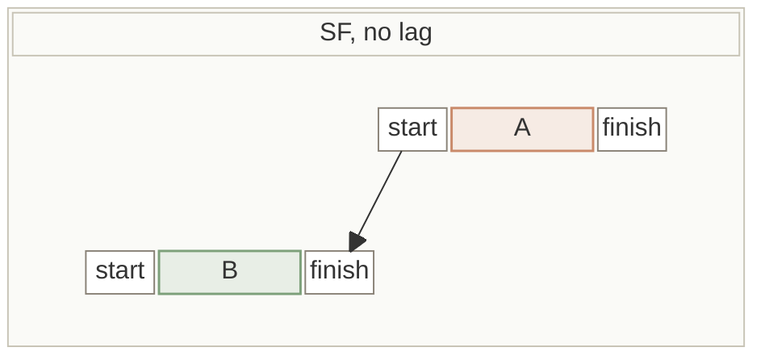

**This page is for Python developers** who want to use TruePPM's scheduling math in their own code — an end user never installs anything here; it's what runs behind the scenes on the Schedule view and the Monte Carlo forecast. The scheduling engine ships independently as [`trueppm-scheduler`](https://pypi.org/project/trueppm-scheduler/) on PyPI, with no dependency on the rest of TruePPM.

```bash
pip install trueppm-scheduler
```

Every modeling convention the engine commits to — lag units, the constraint set, the
sampling distribution, float definitions, progress rules — is listed on one page,
with where each differs from MS Project and Primavera P6:
[Scheduler Conventions](/features/scheduler-conventions/).

## Interactive notebooks

| Notebook | Contents |
|----------|----------|
| [`01-cpm-quickstart.ipynb`](https://gitlab.com/trueppm/trueppm/-/blob/main/packages/scheduler/notebooks/01-cpm-quickstart.ipynb) | Project definition, CPM run, per-task float table, custom calendar, SS dependency, cycle detection, JSON round-trip |
| [`02-monte-carlo.ipynb`](https://gitlab.com/trueppm/trueppm/-/blob/main/packages/scheduler/notebooks/02-monte-carlo.ipynb) | PERT three-point estimates, Monte Carlo run, P50/P80/P95 output, matplotlib histogram, scenario comparison |
| [`03-calendar-aware.ipynb`](https://gitlab.com/trueppm/trueppm/-/blob/main/packages/scheduler/notebooks/03-calendar-aware.ipynb) | Mon–Sat weeks, public holiday exceptions, multi-week shutdown blocks, calendar-day lag snapped to working days, JSON round-trip |
| [`04-performance-bench.ipynb`](https://gitlab.com/trueppm/trueppm/-/blob/main/packages/scheduler/notebooks/04-performance-bench.ipynb) | Full-recompute timing on a 500-task chain, determinism check, local bench |

```bash
# Run locally (from repo root)
pip install -e "packages/scheduler[dev]" matplotlib
jupyter notebook packages/scheduler/notebooks/
```

## Critical Path Method

`schedule()` performs a forward pass, backward pass, float calculation, and critical-path identification on a directed acyclic graph of tasks and dependencies.

### Dependency types

| Code | Name | Constraint |
|------|------|-----------|
| `FS` | Finish-to-Start | Successor starts after predecessor finishes (+ lag) |
| `SS` | Start-to-Start | Successor starts after predecessor starts (+ lag) |
| `FF` | Finish-to-Finish | Successor finishes after predecessor finishes (+ lag) |
| `SF` | Start-to-Finish | Successor finishes after predecessor starts (+ lag) |

Negative lag (lead) is supported on every type.

Each diagram below shows the predecessor (A) above the successor (B), with time running left to right. Each task is one bar whose start and finish ends belong to the task, and the arrow runs from the end of A that the link constrains to the end of B it drives. Lag and lead count calendar days; see [Lag is in calendar days](#lag-is-in-calendar-days-durations-are-in-working-days).

#### FS · Finish-to-Start

B can start once A has finished. This is the default link.



A lag leaves a gap between A's finish and B's start; a lead pulls B's start back so the two bars overlap. A lead never snaps backward, so a weekend can absorb a short one.

#### SS · Start-to-Start

B can start once A has started, so the two tasks run in parallel.



With a lag, B starts a set number of calendar days after A starts.

#### FF · Finish-to-Finish

B can finish once A has finished, so both tasks end together.



With a lag, B finishes a set number of calendar days after A finishes. B stays contiguous and right-aligned on that finish.

#### SF · Start-to-Finish

B can finish once A has started, so B sits before A.



With no lag, B ends the working day before A starts. The rule below also covers a positive lag.

`FF` and `SF` constrain the successor's **finish**, and a finish is the *end* of
its last working day. An `SF` link with zero lag therefore lets the successor
finish at the *start* of the predecessor's first day, which puts the
successor's last working day on the working day **before** the predecessor
starts. This is the MS Project and Primavera P6 reading, and it is the same for
a task predecessor and a milestone predecessor. A positive lag counts from the
predecessor's start itself, not from that earlier working day, so a weekend just
before the start does not absorb it: a predecessor starting Monday with `SF+2d`
finishes its successor on Tuesday, as MS Project does.

#### Lag is in calendar days, durations are in working days

The two inputs are counted in different units, which is the single most common
source of surprise in the engine:

| Input | Unit |
|-------|------|
| `Task.duration` (and each PERT estimate) | **Working days** — weekends and `Calendar.exceptions` are skipped |
| `Dependency.lag` | **Calendar days** — applied as elapsed time; only the *resulting date* is then snapped to the successor's next working day |

A 5-working-day task starting Monday finishes Friday. But a 2-day FS lag after a
Friday finish does not buy two working days of wait, because the weekend absorbs
it — the successor still starts Monday:

| FS `lag` after a Friday finish | Successor starts | Working days of delay |
|---|---|---|
| `0d` | Mon | 1 |
| `1d` | Mon | 1 |
| `2d` | Mon | 1 |
| `3d` | Tue | 2 |
| `4d` | Wed | 3 |

To express a wait of *n* working days, either size the lag against the calendar
the successor lands on, or model the wait as a zero-resource task — durations are
working-day counted, so that path is calendar-aware end to end.

Negative lag (a lead) follows the same rule and also snaps **forward**, never
backward, to the next working day. A lead that pulls the candidate date into a
weekend does not borrow the working day before it — it lands on the working day
after:

| FS `lag` after a Friday finish | Successor starts |
|---|---|
| `-7d` | Mon 01-05 (candidate is Sat 01-03, which snaps forward — **not** Fri 01-02) |

:::note
Whether lag *should* be working-day counted — MS Project's default duration-unit
lag, with `ed` as the elapsed-day opt-in — is an open engine-semantics question
tracked in [#2535](https://gitlab.com/trueppm/trueppm/-/issues/2535). Today's
behavior is calendar-day lag, as described above.
:::

### Output fields

| Field | Type | Description |
|-------|------|-------------|
| `early_start` | `date` | Earliest date the task can start |
| `early_finish` | `date` | Earliest date the task can finish |
| `late_start` | `date` | Latest start without delaying the project |
| `late_finish` | `date` | Latest finish without delaying the project |
| `total_float` | `timedelta` | Working days of slack before the task delays the project end |
| `free_float` | `timedelta` | Working days a task can slip without moving any live successor's early dates (see note) |
| `is_critical` | `bool` | `True` when `total_float == timedelta(0)` and the task is not complete (a completed task keeps zero float but is never critical) |

:::note
`free_float`, `total_float`, and `is_critical` all account for **all four**
dependency types — an SS, FF, or SF successor pins a task's free float exactly as
an FS successor does. Four behaviors are worth knowing:

- **Completed successors are skipped.** A successor with an `actual_finish` is out
  of network logic (ADR-0136) and cannot bound its predecessor's slip, so it does
  not tighten free float.
- **A task with no live successor falls back to its total float.** There is
  nothing downstream for it to move, so its free float is its total float.
- **A milestone successor is measured by the day it is shown on.** A milestone
  shown at the start of a working day may move to any midnight in the
  non-working time before that day without moving. For example,
  `A(4d) -FS+2d-> M` places `M` at Sunday midnight, shown on Monday, and a
  one-day slip of `A` only moves it to Monday midnight, so `A` has one day of
  free float. The exception is when a lag on one of `M`'s own links would carry
  that move further downstream. A milestone shown at the end of a day stays
  fixed: `A -FS+1d-> M` (shown on Friday) leaves `A` with no free float, because a
  one-day slip moves `M` to Monday.
- **A successor that started on a non-working day is measured from the next
  working day.** A recorded `actual_start` is kept as entered, even on a
  Saturday, and a Saturday start is the same point in working time as the
  Monday after it. A predecessor whose link only reaches the Friday before can
  slip to Monday without moving that successor's work, so it keeps that day of
  free float and is not reported as the successor's driving link
  ([#4332](https://gitlab.com/trueppm/trueppm/-/issues/4332)). The same holds
  through a milestone: how far a milestone may move before such a successor
  moves is measured from that Monday too, so the milestone's own predecessors
  keep the same free float
  ([#4345](https://gitlab.com/trueppm/trueppm/-/issues/4345)).
:::

### Which float answers which question

The two are easy to conflate and they support different decisions, so it is worth
naming them apart:

- **`total_float`** is how long the task can slip before **the project finish**
  moves. It is the number that defines the critical path: `is_critical` means
  `total_float == 0` on a task that is not complete. A completed task also has zero
  float but is never critical.
- **`free_float`** is how long it can slip before **its own successors** have to
  move. It is bounded by the nearest downstream early start, not by the project
  end.

`free_float <= total_float` always holds. They are equal when the task has no
live successor, or when every successor that bounds it has no float of its own: in
an A → B chain where B is critical, A has both at zero, and a critical successor
that starts days after A leaves A with the same free and total float. They differ
when a bounding successor has float of its own: the slack is shared with that
successor, so A → C where C has six days of float gives A six days of total float
but none of free float, because C starts the moment A finishes. The gap between them is where the practical answer
lives: a task carrying eight days of total float and two of free float has eight
days of room in the plan overall, and can only take two of them before the next
task is pushed. Spending the other six is a decision about somebody else's start
date, not a free one — which is why a schedule read on total float alone tends to
under-count the disruption a slip causes.

### Calendar arithmetic

Working-day arithmetic skips weekends and any dates listed in `Calendar.exceptions` (`DateRange` entries). It governs task duration expansion and float counting. Dependency lag is applied in calendar days and then snapped to a working day — see [Lag is in calendar days](#lag-is-in-calendar-days-durations-are-in-working-days) above.

:::note
Scheduling is in **whole working-day units**. `Calendar.hours_per_day` and `Calendar.timezone` round-trip through serialization for API parity but are not consumed by the CPM or Monte Carlo passes — they do not change any computed date. Sub-day scheduling is a future change.

Durations and estimates are expressed in whole working days for the beta, lags in whole calendar days (above). **Neither unit is a stable contract before GA** — a finer canonical unit (minutes) and an effort/duration split are planned, so do not depend on the day granularity as a fixed API guarantee. Import/export adapters that must cross into hours (MS Project, Jira) do so through a single conversion seam, not scattered constants.
:::

### Cycle detection

`schedule()` raises `CyclicDependencyError` if the graph contains a cycle. The `.cycle` attribute contains the list of task IDs forming the cycle. Starting in 0.5, `.cycle` will be the full canonical path (deterministic regardless of input order, starting at its smallest ID and repeating it at the end), and the message will `repr()`-escape each ID and list at most 10, followed by `… (+M more)`.

### Usage

```python
from datetime import date, timedelta
from trueppm_scheduler import (
    Calendar, DateRange, Dependency, DependencyType,
    Project, Task, schedule, CyclicDependencyError,
)

# Calendar: Mon–Fri, Good Friday excluded
cal = Calendar(
    exceptions=[
        DateRange(start=date(2026, 4, 3), end=date(2026, 4, 3)),
    ]
)

tasks = [
    Task(id="design", name="Design", duration=timedelta(days=5)),
    Task(id="build",  name="Build",  duration=timedelta(days=10)),
    Task(id="test",   name="Test",   duration=timedelta(days=7)),
    Task(id="deploy", name="Deploy", duration=timedelta(days=2)),
]

dependencies = [
    Dependency(predecessor_id="design", successor_id="build"),
    Dependency(predecessor_id="design", successor_id="test"),
    Dependency(predecessor_id="build",  successor_id="deploy"),
    Dependency(predecessor_id="test",   successor_id="deploy"),
]

project = Project(
    id="release-v1",
    name="Release v1.0",
    start_date=date(2026, 4, 1),
    tasks=tasks,
    dependencies=dependencies,
    calendar=cal,
)

try:
    result = schedule(project)
except CyclicDependencyError as e:
    print("Cycle:", e.cycle)

print(f"Finish: {result.project_finish}")
print(f"Critical path: {' → '.join(result.critical_path)}")

for t in result.tasks:
    print(t.name, t.early_finish, "float:", t.total_float.days, "critical:", t.is_critical)
```

Non-FS dependencies use the `dep_type` and optional `lag` arguments:

```python
Dependency(
    predecessor_id="code",
    successor_id="test",
    dep_type=DependencyType.SS,
    lag=timedelta(days=2),
)
```

### JSON round-trip

```python
json_str = project.to_json(indent=2)
project_rt = Project.from_json(json_str)
result_rt = schedule(project_rt)
```

A project built in Python and one loaded from JSON are held to the same field
rules, so any project `schedule()` accepts also survives `to_json()` →
`from_json()` unchanged. That includes fields the engine never reads, such as the
reserved `Calendar.hours_per_day`/`timezone` and the computed task dates and
floats. A field `from_json()` would refuse to load back — a string date, a
`datetime`, an `int` lag, a string `dep_type`, a `working_days` outside
`[0, 127]` — makes `schedule()`, `monte_carlo()`, `to_dict()` and `to_json()`
raise `InvalidScheduleInput`, never a bare `AttributeError` or `TypeError`.
Construction stays lenient: the check runs when the project is scheduled or
serialized, not when it is built.

### CLI

```bash
trueppm-scheduler schedule project.json
trueppm-scheduler schedule project.json --json
```

## Monte Carlo Simulation

`monte_carlo()` runs probabilistic simulation using PERT-Beta distributions: a Beta fitted by method of moments to the classic PERT mean `(O + 4M + P) / 6` and standard deviation `(P − O) / 6`, **not** the λ=4 Beta-PERT that @RISK defaults to. Both share the mean; on a symmetric estimate this band is slightly narrower than @RISK's default, so P80/P95 land a little earlier ([ADR-1245](https://gitlab.com/trueppm/trueppm/-/blob/main/docs/adr/1245-pert-sampler-moment-fit-convention.md), [#4133](https://gitlab.com/trueppm/trueppm/-/issues/4133)). Vectorized with numpy: 10,000 runs on a 200-task project takes about 60–100 ms on a current laptop CPU (measured on Apple Silicon, numpy 2.4) and longer on a shared CI runner or an older server.

**Seeded runs are reproducible within one numpy and one `trueppm-scheduler` version.** `monte_carlo(project, seed=…)` returns the same P50/P80/P95 every time for the same input on the same versions of both packages. numpy only guarantees a random stream within one release, so upgrading numpy — or the scheduler — can move a seeded percentile. Pin both alongside the seed if a baseline must stay bit-identical ([#4099](https://gitlab.com/trueppm/trueppm/-/issues/4099)).

### Three-point estimates

Add `optimistic_duration`, `most_likely_duration`, and `pessimistic_duration` to any task you want sampled stochastically. Tasks without these fields use their deterministic `duration` on every run.

| Field | Meaning |
|-------|---------|
| `optimistic_duration` | Best-case (`timedelta`) |
| `most_likely_duration` | Expected case — should match `duration` (`timedelta`) |
| `pessimistic_duration` | Worst-case (`timedelta`) |

All three must be set for a task to be sampled; a partial estimate is ignored. The three values must be internally ordered (`optimistic <= most_likely <= pessimistic`) or `schedule()` and `monte_carlo()` both raise `InvalidScheduleInput`.

**Sampled durations are floored at `Task.duration`.** `duration` is what the deterministic pass lays out, so a sample below it would make `monte_carlo()` forecast a finish `schedule()` has already ruled infeasible. Each sampled column is clamped up to `duration` before the network is solved — the PERT path and the velocity path alike. The practical consequence for a library consumer: setting a triple *below* `duration` does not pull the forecast in, it collapses that task to its deterministic duration. To model a task finishing faster than planned, lower `duration`. Risk *above* the plan passes through untouched.

:::caution[FF / SF networks]
CPM is not monotone in duration where a Finish-to-Finish or Start-to-Finish link is present: such a link pins a task's finish, so a longer task starts earlier and an SS successor keyed on that start inherits the earlier start. `schedule()` shows this on its own — raising every duration can move the deterministic finish backwards. On such a network a percentile can still precede the deterministic finish, with `monte_carlo()` reproducing `schedule()` faithfully per sampled scenario. FS/SS networks are unaffected. This is the engine's decided convention, not an open defect: an FF/SF-driven task stays contiguous and right-aligned on its pinned finish, as MS Project renders it ([#3806](https://gitlab.com/trueppm/trueppm/-/issues/3806)).
:::

### Output

| Field | Description |
|-------|-------------|
| `runs` | Number of simulations executed |
| `p50` | Completion date in 50% of simulations |
| `p80` | Completion date in 80% of simulations (recommended stakeholder commitment date) |
| `p95` | Completion date in 95% of simulations (contractual deadline buffer) |
| `distribution` | Full sorted list of completion dates (one per run) |
| `sensitivity` | Duration-sensitivity tornado: `[{task_id, index}]`, the tasks whose duration moves the finish most, sorted by `index` (absolute rank correlation, 0–1) descending |

#### Sensitivity (what's holding the date)

`sensitivity` ranks tasks by how strongly their sampled duration drives the project
finish: the absolute Spearman rank correlation between each task's per-run duration
and the project completion date. This is the standard duration-sensitivity tornado —
it answers *"which tasks do I protect to hold the date?"* It accounts for network
position, so a high-variance task with lots of float ranks low (its slack absorbs the
variance) while a task on the binding path ranks high. Tasks whose duration cannot
vary the finish (deterministic durations, completed tasks, zero-duration milestones)
are omitted; a fully deterministic project returns an empty list. The list is capped
to the top entries.

### Usage

```python
from datetime import date, timedelta
from trueppm_scheduler import Calendar, Dependency, Project, Task, monte_carlo, schedule

def days(n: int) -> timedelta:
    return timedelta(days=n)

tasks = [
    Task(
        id="design", name="Design",
        duration=days(5),
        optimistic_duration=days(3),
        most_likely_duration=days(5),
        pessimistic_duration=days(10),
    ),
    Task(
        id="build", name="Build",
        duration=days(15),
        optimistic_duration=days(10),
        most_likely_duration=days(15),
        pessimistic_duration=days(25),
    ),
    # No PERT estimates — deterministic every run
    Task(id="deploy", name="Deploy", duration=days(2)),
]

project = Project(
    id="release-mc",
    name="Release v1.0 (Monte Carlo)",
    start_date=date(2026, 4, 1),
    tasks=tasks,
    dependencies=[
        Dependency(predecessor_id="design", successor_id="build"),
        Dependency(predecessor_id="build",  successor_id="deploy"),
    ],
    calendar=Calendar(),
)

# CPM deterministic baseline
cpm = schedule(project)
print(f"CPM finish (the floor): {cpm.project_finish}")

# Monte Carlo
mc = monte_carlo(project, runs=10_000, seed=42)
print(f"P50: {mc.p50}")
print(f"P80: {mc.p80}  ← recommended commitment date")
print(f"P95: {mc.p95}")

# Measure the slip in working time. Subtracting the two shown days would count a
# weekend hop as slip: the end of a Friday and the start of the next Monday are
# the same point in working time.
def working_days_after(finish: date, shown: date, at_day_start: bool, cal: Calendar) -> int:
    """Working days from the end of ``finish`` to the point ``shown`` marks."""
    if shown <= finish:
        return 0
    count = 0
    day = finish + timedelta(days=1)
    while day <= shown:
        count += cal.is_working_day(day)
        day += timedelta(days=1)
    # A start-of-day finish is the end of the working day before it.
    if at_day_start and cal.is_working_day(shown):
        count -= 1
    return max(count, 0)

slip = working_days_after(cpm.project_finish, mc.p80, mc.p80_at_day_start, project.calendar)
print(f"P80 vs CPM: +{slip} working days of schedule risk")
```

The library exposes the two shown days and which edge of the day each Monte Carlo percentile sits on (`p50_at_day_start`, `p80_at_day_start`, `p95_at_day_start`), not a ready-made difference. The snippet above counts working days with `Calendar.is_working_day`, the same predicate the engine uses. The API computes this for you: its Monte Carlo forecast carries `delta_vs_cpm`, each percentile against the CPM finish, read in working time but reported in calendar days: it is the calendar-day gap between the two end-of-working-day positions, so a P80 one working week after the CPM finish gives 5 here and 7 from the API. See the [display rule](/features/scheduler-conventions/) for why two shown days are never subtracted. The snippet assumes the CPM finish is the end of a working day, which holds when the project ends in work rather than in a milestone.

:::tip P80 is the commitment date

On a network of FS and SS links the CPM deterministic finish is the earliest any simulated run can finish — the plan with no slip — so the chance of hitting the date shown in a traditional Gantt chart is low, and it falls as more work carries an estimate. P50 is later by the expected slip. Commit to the P80 date to reflect realistic schedule risk.

:::

### CLI

```bash
# Summary output
trueppm-scheduler monte-carlo project.json

# JSON output with full per-run distribution (for frontend histograms)
trueppm-scheduler monte-carlo project.json --json --distribution
```

## Errors and input limits

Every exception the engine *documents* raising subclasses `ValueError` (via the
common `SchedulerError` base), so one `except ValueError` catches them all — but
each is individually catchable.

| Exception | Raised when |
|-----------|-------------|
| `CyclicDependencyError` | The dependency graph contains a cycle. `.cycle` holds the offending task IDs. |
| `SimulationCapExceeded` | `monte_carlo(runs=…)` exceeds `max_runs`, or the project has more tasks than `max_tasks`. Both caps default to `None` (no limit; `runs` above an absolute 100,000,000 is always refused) — they are opt-in guards for an embedder exposing the engine to untrusted input. |
| `InvalidScheduleInput` | The input is structurally valid but out of range, or the wrong type (see below), including `monte_carlo`'s own `sensitivity_cap`, `max_runs`, `max_tasks`, `max_lag_delta_cells` and `max_index_cells`. Messages that echo a value cap it at 200 characters. |
| `UnknownTaskError` | `derive_value(project, task_id, …)` is called with a `task_id` that names no task in the project, or (with a supplied `result`) a dependency of that task names a task the `result` lacks. |

**What this guarantee actually covers.** `Project.from_dict()` / `Project.from_json()`
— the untrusted-input path — type-check and coerce every field, so a malformed
document of *any* shape raises `InvalidScheduleInput` and never a bare
AttributeError/TypeError. Constructing `Project`/`Task`/`Dependency` directly in
Python (the **direct-object API**, as in every example above) is held to the same
field rules `from_dict()` applies, on every field of `Project`, `Task`,
`Dependency` and `Calendar` — including the fields the engine never reads: the
reserved `Calendar.hours_per_day` (a finite number) and `timezone` (a string), the
computed task dates (`early_start` … `scheduled_start`, plain `date` or `None`)
and floats (`total_float`/`free_float`, `timedelta`), the `is_critical` and
`milestone_at_day_end` flags (`bool`), and `delivery_mode` (a `DeliveryMode` or
`None`, not the string `"scrum"`). `Calendar.working_days` must be an integer in
`[0, 127]`, and a `calendars` registry must be keyed by string ids. A wrong-typed
or out-of-range value (`None`, a string, a `datetime`, a bare int where a list or
`timedelta` is expected, an unhashable value, …) makes `schedule()` and
`monte_carlo()` raise `InvalidScheduleInput`, not a bare Python exception.
(`derive_value()` applies the same check when it schedules the project itself,
i.e. when called without `result=`.)

So any project `schedule()` accepts round-trips: `Project.from_json(p.to_json())`
loads it back unchanged and schedules it identically. `to_dict()` and `to_json()`
on `Project` (and `to_dict()` on `Task`, `Dependency` and `Calendar`) apply the
same rules and raise `InvalidScheduleInput` for a field they cannot serialize.
Construction itself stays lenient — the check runs when a project is scheduled or
serialized, so an object can be built partially and filled in first.
`tests/test_exception_contract.py` pins the per-field guarantee with a
single-field-mutation sweep over the init fields × 12 adversarial values × both
`schedule()`/`monte_carlo()` entry points (`Task.id` is excluded from that sweep;
a non-string task id is covered by the explicit examples in
`tests/test_contract_fuzz.py`), and `tests/test_roundtrip_contract.py`
property-tests the round trip, so a future field addition that reopens a gap fails
a test rather than becoming a silent leak.

Because the engine walks the working calendar one day at a time, it validates
input up front rather than spinning on a degenerate project (a calendar with no
working day, or a century-long duration, would otherwise drive the day-by-day
walk to the `date` ceiling and raise an opaque `OverflowError`):

| Input | Limit |
|-------|-------|
| `Calendar.working_days` | An integer bitmask in `[0, 127]` that sets at least one weekday bit (Mon–Sun). A calendar whose `exceptions` blanket the whole search window is also rejected. |
| Task `duration` (and each PERT estimate) | `0` to `MAX_DURATION_DAYS` (`36_525`, ~100 years); negatives rejected. |
| `Dependency.lag` | Within `±MAX_LAG_DAYS` (`36_525`). |
| Dependency count | At most `MAX_DEPENDENCIES` (`100_000`) edges. |
| Cumulative project span | Sum of every task's worst-case duration + every lag must stay under `MAX_PROJECT_SPAN_DAYS` (`366_000`, ~1000 years), regardless of task count. |
| `monte_carlo(runs=…)` | Must be `>= 1`. |

`Project.from_json()` rejects the non-standard JSON literals `NaN`, `Infinity`,
and `-Infinity`.

```python
from trueppm_scheduler import schedule, InvalidScheduleInput

try:
    result = schedule(project)
except InvalidScheduleInput as e:
    print("Bad input:", e)
```

:::note
Every `MAX_*` cap is exported from the top-level `trueppm_scheduler` package — the
surface the API stability policy covers — so an application embedding the engine
(such as the TruePPM API) can enforce the same bounds at its own edge instead of
letting them drift:

```python
from trueppm_scheduler import MAX_DEPENDENCIES, MAX_DURATION_DAYS, MAX_LAG_DAYS
```
:::

## Pre-flight helpers

Two exported helpers let an embedder validate and normalize a graph at its own API
edge, without building a full `Project` or paying for a CPM pass.

### `find_cycle()` — reject a bad edge on write

```python
from trueppm_scheduler import find_cycle

# Raw (predecessor_id, successor_id) tuples — no model objects needed.
edges = [("design", "build"), ("build", "test"), ("test", "design")]

check = find_cycle(edges)
if check:                     # truthy when a cycle WAS found
    return 400, {"cycle": check.cycle}
    # check.cycle == ['design', 'build', 'test', 'design']
```

`CycleCheck.cycle` is the cycle as an ordered list of task IDs with the first
repeated at the end, so a UI can render an unambiguous path; it is `None` when the
graph is acyclic. Because it takes raw tuples, this is the cheap check to run when
validating a *single proposed dependency* before persisting it — you do not have
to construct `Task` and `Dependency` objects just to answer "would this close a
loop?".

Pass the optional `children_map` to also catch logical cycles that only exist
through summary tasks (a summary depending on one of its own descendants):

```python
find_cycle(edges, children_map={"phase-1": ["design", "build"]})
```

### `expand_summary_dependencies()` — flatten summary-level links

A planner can draw a dependency on a *summary* task, but CPM operates on leaves.
This fans those links out to the cross-product of the endpoints' leaf descendants
and drops the summaries from the task list:

```python
from trueppm_scheduler import expand_summary_dependencies

expansion = expand_summary_dependencies(
    tasks,          # including the summary tasks
    dependencies,   # may reference summaries
    children_map={"phase-1": ["design", "build"], "phase-2": ["test", "ship"]},
)

expansion.tasks         # input tasks with summaries removed — leaves only
expansion.dependencies  # leaf-level edges, self-links skipped and deduplicated
```

:::note[Ships in 0.5]
In 0.4, a link between a summary and one of its own subtasks (or a summary linked
to itself) is skipped as a self-link, or turned into an order between sibling
tasks. In 0.5 the call will refuse it with `CyclicDependencyError` instead, the same
input `find_cycle` reports as a cycle. A Start-to-Start or Start-to-Finish link *from*
a summary will still raise `InvalidScheduleInput`, as described below.
:::

When two links resolve to the same leaf pair — say `build → test` and
`phase-1 → test` with a 7-day lag — they merge into one edge that keeps the
**largest** lag, so the result never depends on the order of `dependencies`. If the
two links have *different* types (one `FS`, one `FF`), no single edge can hold both,
and the call raises `InvalidScheduleInput` naming both links.

`SummaryExpansion` also unpacks as a pair for backward compatibility:
`leaf_tasks, expanded_deps = expand_summary_dependencies(...)`.

:::caution
A **start-anchored link *from* a summary** — `SS` or `SF` with a summary as the
*predecessor* — is rejected with `InvalidScheduleInput` rather than expanded. A
summary's start is its earliest-starting leaf, but the cross-product preserves the
dep type across *every* leaf, which turns the successor's `max()` over its
predecessors into "wait for the last-starting leaf" and silently over-constrains it
by up to the summary's whole span (ADR-0370). `FS` and `FF` links from a summary
anchor on the finish and expand correctly.
:::

## Auto-scheduling in the API

The `recalculate_schedule` Celery task fires automatically via `transaction.on_commit()` after every Task or Dependency write:

1. Acquires a per-project Valkey lock (`SET NX`) — prevents redundant concurrent recalculations
2. Fetches all live (non-deleted) tasks and dependencies for the project
3. Calls `trueppm-scheduler`'s `schedule()` function
4. Writes CPM output fields back to Task rows
5. Broadcasts a `cpm_complete` WebSocket event (plus per-task `task_dates_updated` deltas) to all connected clients

If the lock is already held, the task re-queues itself with a 10-second countdown.

## Status and roadmap

The engine's known limitations against the current release, what 0.5 is
committed to fixing, and the capability sequence beyond that are tracked in
one canonical place — the scheduler package's own README, since that is what
an embedder (`pip install trueppm-scheduler`) reads first:

[**Status and roadmap**](https://gitlab.com/trueppm/trueppm/-/blob/main/packages/scheduler/README.md#status-and-roadmap)
in `packages/scheduler/README.md`.

In short: the CPM pass and Monte Carlo simulation are stable. 0.5 will run a
committed hardening pass over the engine
([#3988](https://gitlab.com/trueppm/trueppm/-/issues/3988)) rather than ship
new scheduling features. 0.6 and later sequence the agent write path,
sub-day scheduling, and resource leveling as a capability **order of work**,
not a dated schedule — see the [roadmap](/overview/roadmap/) for the full
rationale.
